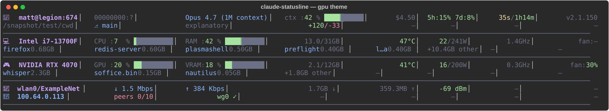
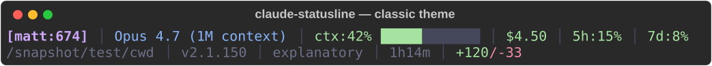
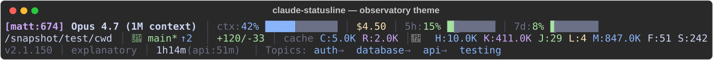

# claude-statusline

A dashboard statusline for [Claude Code](https://claude.com/claude-code): 16 themes × 9 color palettes, from a one-line classic to a full hardware-telemetry grid with CPU/RAM/GPU/network sections, session tracking, cost and rate-limit awareness, and full payload logging.



*The `gpu` theme: identity, model, context, cost, and rate limits, plus CPU, RAM, GPU, and network telemetry with per-process breakdowns.*

## Features

- **16 themes**: `classic`, `hw`, `observatory`, `zen`, `narrative`, `fleet`, `memory_palace`, `economics`, `git_forge`, `heartbeat`, `archaeologist`, `rice`, `gpu`, `grid`, `classic+grid`, `gpu+grid`
- **9 palettes**: Catppuccin (mocha, macchiato, frappe, latte), Nord (frost, aurora, polar), Solarized (dark, light)
- **Hardware telemetry**: CPU, RAM, GPU (nvidia-smi), network throughput, WiFi signal, Tailscale and WireGuard status. Each section degrades gracefully when its data source is absent.
- **Session tracking**: per-session cost, context percentage, rate-limit windows, topic history, and session numbering, logged to SQLite and monthly JSONL under `~/.claude/local/statusline/`
- **Fixed-width grid engine**: emoji-aware visible-width layout that keeps every column boundary aligned regardless of glyph widths, ANSI styling, or content overflow
- **Terminal-capability aware**: respects `NO_COLOR`, detects truecolor/256/16 depth and terminal width
- **Self-testing**: `uv run hooks/selftest.py` verifies the runtime end to end (Python version, wcwidth, `/proc` paths, external tools, hook imports, theme render)

More themes:





## Install

Requirements: Python ≥ 3.11 and [uv](https://docs.astral.sh/uv/). Hardware sections are Linux-oriented (`/proc`); everything else is portable, and missing sources render as `—`.

```bash
git clone https://github.com/LinuxIsCool/claude-statusline ~/claude-statusline
```

Then in Claude Code:

```
/plugin marketplace add ~/claude-statusline
/plugin install claude-statusline@claude-statusline
```

(Adding the marketplace by GitHub slug `LinuxIsCool/claude-statusline` also works; the local clone is recommended so the statusline render path below stays stable across plugin updates.)

Finally, point the statusline at the renderer in `~/.claude/settings.json`:

```json
{
  "statusLine": {
    "type": "command",
    "command": "uv run --script /home/YOU/claude-statusline/hooks/status.py"
  }
}
```

Verify with `uv run hooks/selftest.py`, then start a new Claude Code session.

### Optional: GPU sampler daemon

GPU queries are kept off the render path by a small sampler that keeps a cache warm. If you want GPU stats in the `gpu`/`hw` sections, run `scripts/gpu-sampler.py` as a user service (a systemd unit is a few lines; ExecStart it with `/usr/bin/python3 /path/to/clone/scripts/gpu-sampler.py`).

## Commands

- `/status` shows current statusline configuration and recent stats
- `/theme [name]` cycles or switches themes
- `/color [name]` cycles color palettes independently
- `/configure` views or sets defaults
- `/selftest` runs runtime capability verification

Defaults live in `config/defaults.yaml`; runtime overrides in `~/.claude/local/statusline/config.yaml`.

## Architecture

**Functional core / imperative shell.** `lib/themes.py` contains no I/O. Every theme renderer is a pure function of `(components, palette) → string`. All env reads, subprocess calls, and filesystem reads are consolidated in `compute_*` functions in `lib/components.py` at the shell layer. Hooks are PEP-723 scripts (`uv run` materializes their dependencies on first use).

Notable modules:

- `lib/layout_grid.py`: declarative colspan grid; every `│` lands on a fixed column boundary, with ANSI-aware, style-preserving truncation for overflowing cells
- `lib/primitives.py`: emoji-aware `visible_len`, `Styled` (text, visible-width) pairs, and a width-override table for glyphs terminals disagree about
- `lib/result.py`: `Result[T, E]` for explicit error channels
- `lib/subprocess_caps.py`: capability blackout (60s skip after a subprocess timeout) so a wedged external tool cannot stall renders
- `lib/terminal_caps.py`: `NO_COLOR`, color depth, width, OSC 8 detection

**Persona awareness** is optional: if a `claude-personas` checkout or a claude-emoji database is present, it enriches the identity cell (glyphs, colors); absent, everything falls back cleanly.

## Development

```bash
uv run --extra test pytest          # 329 tests: snapshot, property-based (Hypothesis), integration
UPDATE_SNAPSHOTS=1 uv run --extra test pytest tests/test_theme_snapshots.py   # accept new golden output
```

Golden files under `tests/golden/` baseline all 16 themes; any visual regression is caught on the next run.

## License

MIT
